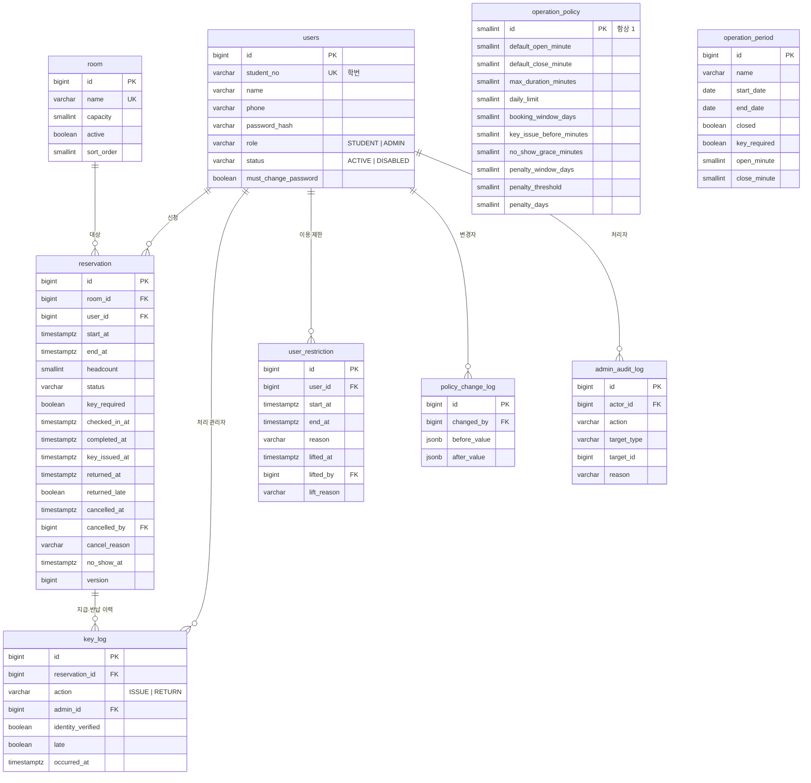

# M-SPACE ERD

- 문서 버전: v0.1 (2026-10-12) · 근거: `요구사항.md` v0.2
- DB: PostgreSQL 17, `btree_gist` 확장 사용 · 구현: `backend/src/main/resources/db/migration/V1__init.sql`
- 공통 규칙: PK는 `bigint generated always as identity`, 시각은 `timestamptz`(UTC 저장, 판단은 Asia/Seoul), 모든 테이블에 `created_at`. 값이 바뀌는 테이블은 `updated_at`도 둬요.

## 1. 다이어그램



## 2. 테이블 상세

### users — 회원 (AU-01, AU-06~08)
| 컬럼 | 타입 | 제약 | 설명 |
|---|---|---|---|
| id | bigint | PK | |
| student_no | varchar(20) | NOT NULL, UNIQUE | 학번. 관리자는 직번 등 로그인 ID |
| name | varchar(50) | NOT NULL | |
| phone | varchar(20) | NOT NULL | `010-1234-5678` 형식으로 정규화해 저장 |
| password_hash | varchar(100) | NOT NULL | BCrypt |
| role | varchar(20) | NOT NULL, CHECK IN ('STUDENT','ADMIN') | |
| status | varchar(20) | NOT NULL, CHECK IN ('ACTIVE','DISABLED') | AU-08 비활성화 |
| must_change_password | boolean | NOT NULL DEFAULT false | AU-07 임시 비밀번호 |
| created_at / updated_at | timestamptz | NOT NULL | |

- 이메일은 받지 않아요(D-2).
- 비활성화된 계정의 학번으로 다시 가입할 수 있어야 해서(AU-08), 학번 UNIQUE는 **`status = 'ACTIVE'`인 행에만** 거는 부분 유니크 인덱스예요.
  ```sql
  CREATE UNIQUE INDEX uq_users_student_no_active ON users (student_no) WHERE status = 'ACTIVE';
  ```

### room — 방 (AD-05)
| 컬럼 | 타입 | 제약 | 설명 |
|---|---|---|---|
| id | bigint | PK | |
| name | varchar(30) | NOT NULL, UNIQUE | `1번방` |
| capacity | smallint | NOT NULL, CHECK (capacity > 0) | |
| active | boolean | NOT NULL DEFAULT true | false면 새 예약 불가. 삭제하지 않음 |
| sort_order | smallint | NOT NULL DEFAULT 0 | 현황판 표시 순서 |
| created_at / updated_at | timestamptz | NOT NULL | |

초기 데이터: 1~4번방(정원 4), 5번방(정원 8) — Flyway 마이그레이션으로 넣어요.

### reservation — 예약 (RV-*, KY-*, NS-01)
| 컬럼 | 타입 | 제약 | 설명 |
|---|---|---|---|
| id | bigint | PK | |
| room_id | bigint | FK → room, NOT NULL | |
| user_id | bigint | FK → users, NOT NULL | 신청자 |
| start_at / end_at | timestamptz | NOT NULL, CHECK (end_at > start_at), 30분 단위 CHECK(`ck_reservation_slot`) | 운영 시간·최대 이용 시간 검사는 애플리케이션(정책이 날짜마다 달라서) |
| headcount | smallint | NOT NULL, CHECK (headcount > 0) | 정원 이하 검사는 애플리케이션(room 참조) |
| status | varchar(20) | NOT NULL, CHECK IN ('RESERVED','IN_USE','RETURNED','COMPLETED','CANCELLED','NO_SHOW') | |
| key_required | boolean | NOT NULL | 생성 시점의 운영 기간으로 정한 값. 이후 기간을 고쳐도 바뀌지 않아요 (OP-01) |
| checked_in_at | timestamptz | | 개방 기간 셀프 체크인 시각 (OP-02) |
| completed_at | timestamptz | | 개방 기간 이용 종료 시각 (OP-03) |
| key_issued_at | timestamptz | | 키 지급 시각 |
| returned_at | timestamptz | | 반납 확인 시각 |
| returned_late | boolean | | 반납 시 연체였는지 (KY-03) |
| cancelled_at | timestamptz | | |
| cancelled_by | bigint | FK → users | 본인 또는 관리자 |
| cancel_reason | varchar(200) | | 관리자 취소 시 필수(애플리케이션) |
| no_show_at | timestamptz | | 스케줄러 처리 시각 |
| version | bigint | NOT NULL DEFAULT 0 | 낙관적 잠금. 키 지급과 노쇼 처리가 동시에 일어날 때 하나만 반영돼요 |
| created_at / updated_at | timestamptz | NOT NULL | |

제약과 인덱스:
```sql
-- RV-03 같은 방 시간 겹침 금지 (동시 신청 시 1건만 성공)
ALTER TABLE reservation ADD CONSTRAINT ex_reservation_room_time
  EXCLUDE USING gist (room_id WITH =, tstzrange(start_at, end_at, '[)') WITH &&)
  WHERE (status IN ('RESERVED', 'IN_USE'));

-- 한 학생이 같은 시간에 두 방을 잡지 못하게 (하루 한도가 늘어나도 유지)
ALTER TABLE reservation ADD CONSTRAINT ex_reservation_user_time
  EXCLUDE USING gist (user_id WITH =, tstzrange(start_at, end_at, '[)') WITH &&)
  WHERE (status IN ('RESERVED', 'IN_USE'));

-- 상태와 기록 컬럼이 어긋나지 않게
ALTER TABLE reservation ADD CONSTRAINT ck_reservation_state_columns CHECK (
  -- 키 예약은 키 지급으로, 개방 기간 예약은 체크인으로만 IN_USE가 돼요
  (key_required OR (key_issued_at IS NULL AND returned_at IS NULL)) AND
  (NOT key_required OR (checked_in_at IS NULL AND completed_at IS NULL)) AND
  (status <> 'IN_USE'    OR key_issued_at IS NOT NULL OR checked_in_at IS NOT NULL) AND
  (status <> 'RETURNED'  OR (key_required AND key_issued_at IS NOT NULL AND returned_at IS NOT NULL AND returned_late IS NOT NULL)) AND
  (status <> 'COMPLETED' OR (NOT key_required AND checked_in_at IS NOT NULL AND completed_at IS NOT NULL)) AND
  (status <> 'CANCELLED' OR cancelled_at IS NOT NULL) AND
  (status <> 'NO_SHOW'   OR no_show_at IS NOT NULL)
);

CREATE INDEX ix_reservation_start ON reservation (start_at);          -- 현황판·관리자 날짜 조회
CREATE INDEX ix_reservation_user_start ON reservation (user_id, start_at DESC);  -- 내 예약
CREATE INDEX ix_reservation_noshow ON reservation (start_at) WHERE status = 'RESERVED'; -- 노쇼 스케줄러
CREATE INDEX ix_reservation_autocomplete ON reservation (end_at) WHERE status = 'IN_USE' AND NOT key_required; -- 자동 이용 종료
```

**1인 하루 한도(RV-06)** 는 개수 제한이라 DB 제약으로 표현할 수 없어요. 예약 생성 트랜잭션에서 신청자 `users` 행을 `SELECT … FOR UPDATE`로 잡고 개수를 세요. 같은 학생의 동시 요청만 직렬화되고 다른 학생에게는 영향이 없어요. (겹침 금지는 여전히 EXCLUDE 제약이 책임져요.)

### key_log — 키 지급·반납 이력 (KY-05)
| 컬럼 | 타입 | 제약 | 설명 |
|---|---|---|---|
| id | bigint | PK | |
| reservation_id | bigint | FK → reservation, NOT NULL | |
| action | varchar(10) | NOT NULL, CHECK IN ('ISSUE','RETURN') | |
| admin_id | bigint | FK → users, NOT NULL | 처리 관리자 |
| identity_verified | boolean | NOT NULL | ISSUE면 반드시 true (CHECK) |
| late | boolean | NOT NULL DEFAULT false | RETURN 시 연체 여부 |
| memo | varchar(200) | | |
| occurred_at | timestamptz | NOT NULL | |
| created_at | timestamptz | NOT NULL | |

```sql
ALTER TABLE key_log ADD CONSTRAINT uq_key_log_reservation_action UNIQUE (reservation_id, action); -- 중복 지급·반납 방지
ALTER TABLE key_log ADD CONSTRAINT ck_key_log_issue_verified CHECK (action <> 'ISSUE' OR identity_verified);
-- 수정·삭제 금지: UPDATE/DELETE 시 예외를 던지는 트리거
```

### operation_policy — 운영 정책 (PO-05, AD-06) — 1행만
| 컬럼 | 기본값 | 설명 |
|---|---|---|
| id | 1 | CHECK (id = 1) |
| default_open_minute | 540 (09:00) | 0시 기준 분. 30의 배수 |
| default_close_minute | 1080 (18:00) | 최대 1440(24:00). CHECK close > open |
| max_duration_minutes | 180 | RV-05 |
| daily_limit | 1 | RV-06 |
| booking_window_days | 7 | RV-07 |
| key_issue_before_minutes | 10 | KY-02 |
| no_show_grace_minutes | 15 | NS-01 |
| penalty_window_days | 14 | NS-02 |
| penalty_threshold | 2 | NS-02 |
| penalty_days | 7 | NS-02 |
| updated_at / updated_by | | |

운영 시간을 `time` 대신 **분(smallint)** 으로 둔 이유: 마감 24:00을 Java `LocalTime`으로 표현할 수 없어서예요.

### operation_period — 특별 운영 기간·휴관일 (PO-01~03)
| 컬럼 | 타입 | 제약 | 설명 |
|---|---|---|---|
| id | bigint | PK | |
| name | varchar(50) | NOT NULL | `2026-2 중간고사` |
| start_date / end_date | date | NOT NULL, CHECK (end_date >= start_date) | KST 날짜, 양끝 포함 |
| closed | boolean | NOT NULL DEFAULT false | true면 휴관 |
| key_required | boolean | NOT NULL DEFAULT true | false면 개방 기간(OP-01): 키 대신 앱 체크인 |
| open_minute / close_minute | smallint | closed=false면 NOT NULL, 30의 배수, 0 ≤ open < close ≤ 1440 | |
| created_at / updated_at | timestamptz | NOT NULL | |

```sql
-- 기간끼리 겹치지 않게
ALTER TABLE operation_period ADD CONSTRAINT ex_operation_period_dates
  EXCLUDE USING gist (daterange(start_date, end_date, '[]') WITH &&);
```

### user_restriction — 이용 제한 (NS-02, NS-03)
| 컬럼 | 타입 | 제약 | 설명 |
|---|---|---|---|
| id | bigint | PK | |
| user_id | bigint | FK → users, NOT NULL | |
| start_at / end_at | timestamptz | NOT NULL, CHECK (end_at > start_at) | |
| reason | varchar(200) | NOT NULL | `노쇼 2회 (예약 #12, #31)` |
| lifted_at / lifted_by / lift_reason | | lifted_at이 있으면 나머지도 필수(CHECK) | 관리자 해제 |
| created_at | timestamptz | NOT NULL | |

```sql
-- 해제되지 않은 제한끼리 겹치지 않게 → 스케줄러가 여러 번 돌아도 제한이 중복 생성되지 않아요
ALTER TABLE user_restriction ADD CONSTRAINT ex_user_restriction_active
  EXCLUDE USING gist (user_id WITH =, tstzrange(start_at, end_at, '[)') WITH &&)
  WHERE (lifted_at IS NULL);
```

### policy_change_log — 정책 변경 이력 (AD-06)
`id`, `target`(`POLICY` | `PERIOD`), `target_id`, `changed_by` FK, `before_value` jsonb, `after_value` jsonb, `created_at`. 추가만 해요.

### admin_audit_log — 관리자 조치 기록 (AD-08)
`id`, `actor_id` FK, `action`(`PASSWORD_RESET` | `USER_DISABLE` 등), `target_type`, `target_id`, `reason`, `created_at`. 추가만 해요. 비밀번호·전화번호 같은 값은 넣지 않아요.

## 3. 요구사항 ↔ 테이블

| 요구사항 | 테이블 |
|---|---|
| AU-01~08 | users, admin_audit_log |
| BD-01~05 | reservation, room, operation_policy, operation_period |
| RV-01~13 | reservation, room, operation_policy, operation_period, user_restriction |
| KY-01~07 | reservation, key_log |
| NS-01~03 | reservation, user_restriction |
| OP-01~05 | operation_period, reservation |
| AD-05 | room |
| AD-06, PO-01~05 | operation_policy, operation_period, policy_change_log |

## 4. 변경 이력
| 버전 | 날짜 | 내용 |
|---|---|---|
| v0.1 | 2026-10-12 | 최초 작성 |
| v0.3 | 2026-10-12 | V1 구현: 30분 단위 CHECK(`ck_reservation_slot`), `key_log` 수정·삭제 금지 트리거(`tr_key_log_immutable`), 초기 데이터(방 5개·정책 1행) |
| v0.2 | 2026-10-12 | 개방 기간(D-9): `operation_period.key_required`, `reservation.key_required·checked_in_at·completed_at`, `COMPLETED` 상태 추가 |
