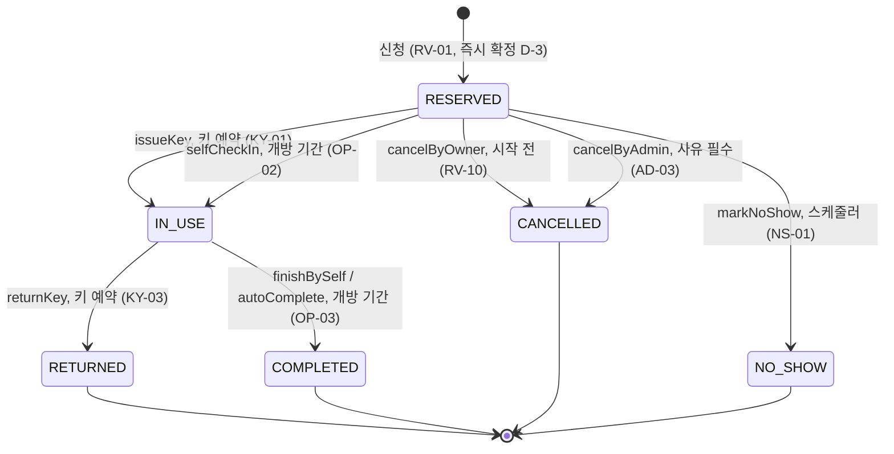

# 예약 상태 설계

- 문서 버전: v0.1 (2026-10-12) · 근거: `요구사항.md` v0.2, `docs/ERD.md` v0.1

## 1. 상태

| 상태 | 뜻 | 시간 겹침 검사 대상 | 하루 한도에 셈 |
|---|---|---|---|
| `RESERVED` | 확정, 키 수령 전 | O | O |
| `IN_USE` | 키 지급됨, 이용 중 | O | O |
| `RETURNED` | 반납 확인 완료 (종료, 키 예약) | X (일찍 반납하면 남은 시간을 다른 사람이 예약 가능) | O |
| `COMPLETED` | 이용 종료 (종료, 개방 기간 예약) | X | O |
| `CANCELLED` | 본인 또는 관리자 취소 (종료) | X | X |
| `NO_SHOW` | 키 미수령 (종료) | X | X (대신 제재 판단에 셈) |

`IN_USE`는 키 예약이면 키 지급, 개방 기간 예약(`key_required = false`)이면 셀프 체크인으로 들어가요.

화면 표시 전용 상태: **`OVERDUE`(연체)** = 키 예약이 `IN_USE`이면서 현재 ≥ `end_at`. 개방 기간 예약은 연체가 없어요. DB에는 저장하지 않아요.

## 2. 전이도

## 3. 전이 메서드 (`Reservation` 엔티티)

상태는 아래 메서드로만 바꿔요. setter는 두지 않아요. 조건에 맞지 않으면 `BusinessException(ErrorCode)`를 던져요.
시각 `now`는 인자로 받아요(테스트에서 시각을 고정하기 위해 `Clock` 주입).

| 메서드 | 허용 상태 | 추가 조건 | 결과 | 실패 코드 |
|---|---|---|---|---|
| `issueKey(admin, identityVerified, now, policy)` | RESERVED | `key_required` `identityVerified == true` `start − key_issue_before ≤ now < start + no_show_grace` | IN_USE, `key_issued_at = now`, `key_log(ISSUE)` 추가 | `INVALID_RESERVATION_STATE`, `IDENTITY_NOT_VERIFIED`, `KEY_ISSUE_NOT_ALLOWED_TIME` |
| `returnKey(admin, now)` | IN_USE | `key_required` | RETURNED, `returned_at = now`, `returned_late = now > end_at`, `key_log(RETURN, late)` 추가 | `INVALID_RESERVATION_STATE` |
| `selfCheckIn(user, now, policy)` | RESERVED | `!key_required`, 본인 `start − key_issue_before ≤ now < start + no_show_grace` | IN_USE, `checked_in_at = now` | `INVALID_RESERVATION_STATE`, `CHECK_IN_NOT_ALLOWED_TIME` |
| `finishBySelf(user, now)` | IN_USE | `!key_required`, 본인 | COMPLETED, `completed_at = now` | `INVALID_RESERVATION_STATE` |
| `autoComplete(now)` | IN_USE | `!key_required`, `now ≥ end_at` | COMPLETED, `completed_at = end_at` | `INVALID_RESERVATION_STATE` |
| `cancelByOwner(user, now)` | RESERVED | 본인, `now < start_at` | CANCELLED, `cancelled_by = user` | `INVALID_RESERVATION_STATE`, `CANCEL_AFTER_START` |
| `cancelByAdmin(admin, reason, now)` | RESERVED | `reason` 비어 있지 않음 | CANCELLED, `cancelled_by = admin`, `cancel_reason` | `INVALID_RESERVATION_STATE` |
| `markNoShow(now, policy)` | RESERVED | `now ≥ start_at + no_show_grace` (키 예약·개방 기간 공통) | NO_SHOW, `no_show_at = now` | `INVALID_RESERVATION_STATE` |

- 이용 중(`IN_USE`) 예약은 취소할 수 없어요. 키 예약은 반납 확인으로, 개방 기간 예약은 이용 종료로 끝내요.
- 키 예약에 셀프 체크인을 하거나 개방 기간 예약에 키 지급을 하면 `INVALID_RESERVATION_STATE`예요.
- 소유자 검사(본인 여부)는 서비스 계층에서 먼저 하고, 남의 예약이면 404(`RESERVATION_NOT_FOUND`)예요.

## 4. 스케줄러 (NS-01, NS-02, OP-03)

### 4.1 노쇼

- `@Scheduled(fixedDelay = 1분)`.
- 대상: `status = 'RESERVED' AND start_at <= now − no_show_grace`. 건별로 `markNoShow` 후 저장해요.
- **멱등성:** 이미 NO_SHOW인 예약은 대상 조회에 걸리지 않아요. 같은 예약을 관리자가 동시에 키 지급하면 `version` 충돌로 둘 중 하나만 반영되고, 스케줄러 쪽은 건너뛰어요(다음 주기에 상태를 다시 보고 판단).
- NO_SHOW로 바뀐 학생마다 제재를 판단해요: 최근 `penalty_window_days` 안의 NO_SHOW 수 ≥ `penalty_threshold`이고 해제되지 않은 유효 제한이 없으면 `user_restriction(now ~ now + penalty_days)`를 만들어요. 동시에 두 번 만들어도 EXCLUDE 제약으로 하나만 남아요(위반은 무시).
- 이미 끝난 제한 기간에 쓰인 노쇼는 다시 세지 않도록, 노쇼 세는 구간 시작을 `max(now − window, 마지막 제한의 start_at)`으로 잡아요.

### 4.2 개방 기간 자동 이용 종료 (OP-03)
- 같은 주기로 `status = 'IN_USE' AND key_required = false AND end_at <= now`인 예약을 `autoComplete` 해요. 이미 COMPLETED면 대상에 걸리지 않아 멱등이에요.

## 5. 예약 생성 검사 순서 (RV-01~07, RV-12)

1. 입력 형식: 30분 단위, `end > start`, 인원 ≥ 1 → `400 VALIDATION_FAILED`
2. 방 존재·활성 → `404 ROOM_NOT_FOUND` / `409 ROOM_INACTIVE`
3. 인원 ≤ 정원 → `400 HEADCOUNT_EXCEEDS_CAPACITY`
4. 시작 > 현재 → `400 RESERVATION_IN_PAST`, 시작 날짜(KST)가 오늘 ~ 오늘 + `booking_window_days` → `400 RESERVATION_OUT_OF_WINDOW`
5. 시작 날짜의 운영 시간(특별 운영 기간 → 기본) 안에서 시작·종료. **자정을 넘길 수 없어요**(마감 24:00이면 종료는 다음 날 00:00까지) → `400 OUTSIDE_OPERATING_HOURS`, 휴관일 → `400 CLOSED_DAY`
6. 이용 시간 ≤ `max_duration_minutes` → `400 RESERVATION_TOO_LONG`
7. 이용 제한 중이 아님 → `403 USER_RESTRICTED` (메시지에 제한 종료일)
8. 신청자 행 잠금 후 그 날짜(KST)의 RESERVED·IN_USE·RETURNED 수 < `daily_limit` → `409 DAILY_LIMIT_EXCEEDED`
9. 시작 날짜의 운영 기간으로 `key_required`를 정해 INSERT. EXCLUDE 위반 → `409 RESERVATION_TIME_CONFLICT` (방 겹침), `409 USER_TIME_CONFLICT` (본인 다른 예약과 겹침)
   - 겹치는 INSERT가 동시에 들어와 EXCLUDE 검사가 서로의 커밋 전 행을 기다리면 PostgreSQL이 한쪽을 교착(`40P01`)으로 끊어요. 끊긴 쪽도 `409 RESERVATION_TIME_CONFLICT`예요(재시도 없음, 교착에는 제약 이름이 없어 `USER_TIME_CONFLICT`와 구분하지 않아요). 예약 생성은 Hibernate(JPA) 경로로 INSERT해야 이 구분이 돼요(실행 SQL로 테이블을 읽어요, TS-16).

## 6. 변경 이력
| 버전 | 날짜 | 내용 |
|---|---|---|
| v0.1 | 2026-10-12 | 최초 작성 |
| v0.2 | 2026-10-12 | 개방 기간(D-9): `COMPLETED` 상태, `selfCheckIn`·`finishBySelf`·`autoComplete` 추가 |
| v0.3 | 2026-10-16 | 5장 9번: 동시 INSERT 교착(`40P01`)도 `409 RESERVATION_TIME_CONFLICT` (TS-16) |
